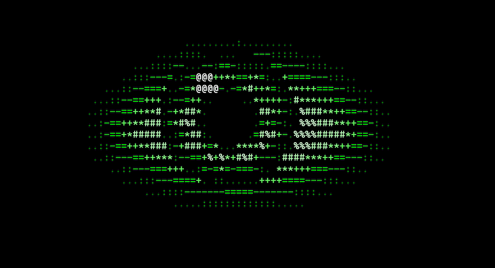

# Oculi

An animated ASCII eye. The eye is drawn by C++ programs; a small Python layer (standard library only) lets scripts and shell commands set its state: `idle`, `working`, `success`, `warning` or `error`.



| Part | File | What it does |
| --- | --- | --- |
| Terminal eye | `eye.cpp` | The eye animation inside a terminal window |
| Desktop eye (Windows) | `eye_widget.cpp` | A small borderless eye in a corner of the screen. It follows the mouse, blinks and reacts to Oculi states |
| Event layer | `oculi.py` | Python API, command runner and the state file that connects Python to the desktop eye |
| Tests | `test_oculi.py`, `test_bridge.py`, `test_runner.py` | `unittest`, no extra packages |

Only the desktop eye reacts to states. The terminal eye is a stand-alone animation and ignores them.

## Features

- Moving iris with fine fibres, breathing pupil, glint and soft reflection
- Natural gaze and random blinks
- Grayscale mode and green mode
- Five states that any Python code or shell command can set
- No dependencies: C++ standard library and Win32 for the eyes, Python standard library for the event layer

## Requirements

- A C++ compiler such as `g++` (MinGW on Windows, GCC or Clang on Linux/macOS)
- **Terminal eye:** a terminal with 256-color support (Windows 10 or newer, or a modern Linux/macOS terminal), at least **61 columns x 23 rows**
- **Desktop eye:** Windows
- **Event layer and command runner:** Python 3.8 or newer (developed and tested with 3.12)

## Download

```
git clone https://github.com/hasheramin5-cyber/Oculi.git
cd Oculi
```

Or click **Code > Download ZIP** on GitHub, extract it and open a terminal in that folder.

---

## 1. Terminal eye

```
g++ eye.cpp -o eye
```

| System | Command |
| --- | --- |
| Windows Command Prompt | `eye` or `eye green` |
| Windows PowerShell | `.\eye` or `.\eye green` |
| Linux / macOS | `./eye` or `./eye green` |

Add `green` for the green version. Press **Ctrl+C** to quit.

## 2. Desktop eye (Windows)

A small, borderless, transparent eye made of text characters. It sits in the bottom-right corner of the screen, stays on top of all windows, looks at the mouse pointer and blinks.

```
g++ eye_widget.cpp -o eye_widget -mwindows -lgdi32 -luser32
eye_widget
```

| Option | What it does |
| --- | --- |
| `--music` | Real-time music-reactive mode (reacts to system audio) |
| `gray` | Black and white instead of green |
| `box` | Adds a dark backing, helpful on bright windows |
| `3` to `8` | Size (3 is smallest, 4 is default) |

Options can be combined, for example `eye_widget --music 3 gray box`.

- **Drag** with the left mouse button to move it.
- **Right-click** the eye to close it, or run `taskkill /IM eye_widget.exe /F`.
- **Start with Windows:** press **Win + R**, run `shell:startup`, and create a shortcut to `eye_widget.exe` in that folder. Delete the shortcut to stop it.

---

## 3. States

| State | Meaning | Desktop eye |
| --- | --- | --- |
| `idle` | Nothing happening (the default) | Normal eye |
| `working` | Something is running | Iris rotates faster |
| `success` | Finished without errors | Green glow and one blink, fading out; goes back to `idle` after 3 seconds |
| `warning` | Needs attention | Slow amber pulse |
| `error` | Something failed | Faster red pulse |

`idle`, `working`, `warning` and `error` stay until the next event.

## 4. Python event API

```python
import oculi

oculi.send(source="training", state="working")
oculi.send(source="training", state="success")

oculi.current_state()        # "success" (reports "idle" again 3 seconds later)
oculi.state_of("training")   # "success"
oculi.send("build", "fire")  # raises oculi.InvalidStateError
```

`send(source, state)` validates the input, remembers the event and updates the state file. It returns an `Event(source, state, timestamp)`. An unknown state raises `InvalidStateError` (a `ValueError`); an empty source raises `ValueError`. Source names are lower-cased. A failure to write the state file never raises.

| Function | Returns |
| --- | --- |
| `current_state()` | The state that is in effect, `"idle"` if there are no events |
| `current_event()` | The most recent `Event`, or `None` |
| `state_of(source)` | The latest state reported by one source, or `None` |
| `sources()` | The latest event of every source that has reported |
| `events()` | The most recent events (up to 100), oldest first |
| `visual()` | The intended look for the current state |
| `reset()` | Forgets all events and publishes `idle` |

Several sources can report at the same time. The most recent event wins; there is no priority between sources.

## 5. Run any command

The command runner reports the outcome of any command without changing the command:

```
python -m oculi run --source training -- python train.py
python -m oculi run --source tests -- pytest -q
python -m oculi run --source build -- g++ eye.cpp -o eye
```

1. `working` is sent before the command starts.
2. The command runs with your stdin, stdout and stderr, so its output and prompts are untouched. Arguments are passed through exactly as written.
3. Exit code `0` sends `success`; any other exit code sends `error`.
4. Oculi exits with the command's own exit code.

`--source` and the `--` before the command are required. Only the first `--` is used by Oculi, so later ones belong to your command.

| Exit code | When |
| --- | --- |
| the command's own | The command ran and finished |
| `127` | The command was not found (`error` is sent) |
| `126` | The command could not be executed because of permissions (`error` is sent) |
| `130` | Interrupted with Ctrl+C (`error` is sent) |
| `128 + N` | The command was killed by signal N (Linux/macOS) |
| `2` | Wrong usage, for example a missing `--source`; the command is not run |

`python -m oculi` finds `oculi.py` in the current folder. To use it from another folder, add the repository folder to `PYTHONPATH` (Command Prompt: `set PYTHONPATH=C:\path\to\Oculi`).

## 6. State file

`send()` publishes every event to one text file, and the desktop eye reads it about every 200 ms. No sockets or servers are involved.

```
%LOCALAPPDATA%\Oculi\state.txt
working 1760000000.123456 training
```

The single line is `<state> <timestamp> <source>`; the timestamp is seconds since 1970 and spaces in a source name become `_`. The file is written to a temporary file first and then moved into place, so the eye never reads a half-written line.

Set the `OCULI_STATE_FILE` environment variable to use another path (an empty value turns the bridge off). The desktop eye reads the same variable, so set it for both processes.

## 7. Music-Reactive Desktop Eye

A native C++ / Win32 real-time audio visualization mode for the Desktop Eye (`eye_widget`). When enabled, the eye dynamically reacts to any active Windows system audio (Spotify, YouTube, media players, games) via WASAPI loopback capture without requiring external drivers or virtual audio cables.

### Commands to Enable and Disable Music Mode

Music mode is optional and disabled by default.

- **Enable Music Mode:**
  ```cmd
  eye_widget --music
  ```
- **Normal Mode (Music Disabled):**
  ```cmd
  eye_widget
  ```
- **Combine with Other Widget Options:**
  ```cmd
  eye_widget --music 3 gray box
  ```

### Audio-to-Visual Parameter Mapping

Audio analysis maps frequency and transient features onto specific visual elements of the eye:

| Audio Feature | Target Visual Element | Visual Response |
| --- | --- | --- |
| **Bass (20–250 Hz)** | Pupil radius ($r_p$) | Natural, smooth pupil dilation and bass pump |
| **Mid frequencies (250–2500 Hz)** | Iris fibers & rotation | Modulates harmonic fiber ripples and spin speed |
| **Treble (2500–16000 Hz)** | Iris boundary / edge | Sharpens collarette and illuminates iris perimeter |
| **RMS Volume** | Overall brightness | Gentle intensity modulation without blowing out highlights |
| **Beat Detection** | Transient pulse | Crisp brightness pulse and immediate pupil onset |
| **Impact State** | Specular glint & reflection | Flares highlight radius and sharp secondary reflection |
| **Groove State** | Synchronized rhythm | Cohesive rhythmic modulation locked to tempo |
| **Dormant State** | Resting baseline | Returns to natural breathing animation during silence |

### State Priority (Music vs Notifications)

Oculi's five core notification states (`idle`, `working`, `success`, `warning`, `error`) take strict priority over music mode:

- **Notification Recognition:** When a task triggers `warning` (amber pulse), `error` (fast red pulse), or `success` (green glow), the state's signature hue and pulse override the visual styling. The internal geometry continues reacting smoothly to audio dynamics beneath the notification tint.
- **Working State:** A `working` event enforces fast iris rotation regardless of audio tempo.
- **Idle State:** When no task notification is active (`idle`), the eye fully expresses music states and beat pulses.

### Audio Architecture

- **Capture:** Windows Audio Session API (WASAPI) loopback capture (`audio_capture.h`, `audio_capture.cpp`) captures system audio directly from the default render endpoint on a dedicated background thread.
- **Analysis:** Real-time digital signal processing (`audio_analysis.h`, `audio_analysis.cpp`) runs an in-place 1024-point Cooley-Tukey Radix-2 FFT with Hann windowing.
- **Smoothing:** Asymmetrical attack/decay ballistic filters eliminate visual jitter while preserving crisp reaction to drum hits and transient onsets.
- **Thread Safety & Non-Blocking:** The rendering loop queries a thread-safe snapshot of smoothed features in sub-microsecond time.
- **Graceful Fallback:** If WASAPI loopback fails to initialize (e.g. no audio output device is present or enabled), `eye_widget` gracefully disables music capture and continues running in normal desktop mode without crashing.

### Requirements

- **Operating System:** Windows 10 or Windows 11.
- **Audio Output:** An active audio render device (speakers, headphones).
- **Build Tools:** CMake 3.15+ and a C++17 compiler (such as MSYS2 UCRT64 GCC, MinGW-w64, or MSVC).

### Build with CMake

```bash
cmake -B build
cmake --build build
```

Run the unit tests:

```bash
build\test_audio.exe
```

Run the live interactive WASAPI capture test (inspect real-time FFT bands and states in console):

```bash
build\test_live_wasapi.exe 5
```

### Troubleshooting

| Issue | Solution |
| --- | --- |
| Eye does not react to music / stays in `Dormant` | Ensure sound is actively playing through your default Windows playback device. Check Windows Sound Settings to verify the device is set as default. |
| No audio playback device connected | Oculi detects missing audio endpoints gracefully and falls back to normal mode. Plug in headphones or speakers to enable audio loopback. |
| Inspecting real-time audio detection | Run `build\test_live_wasapi.exe` in a terminal while playing music to observe live volume bars, frequency bands, beat triggers, and state classifications. |

### Platform Limitations

- WASAPI loopback capture is a Windows-only platform capability.
- Music mode is integrated into the Windows desktop eye widget (`eye_widget`). The standalone terminal eye (`eye.cpp`) remains a lightweight ASCII animation without audio dependencies.

## Tests

```
python -m unittest -v test_oculi test_bridge test_runner
```

The tests use a temporary state file and never touch `%LOCALAPPDATA%`.

## Known limitations

- **No priority between sources.** The latest event wins, so a command that finishes can overwrite the state of another that is still running.
- **A stuck `working` state.** If a runner is killed forcibly (for example `taskkill /F`) or the computer restarts mid-run, the file keeps its last state until the next event. Reset it with `python -c "import oculi; oculi.send('manual', 'idle')"`.
- **Only the desktop eye reacts to states.** It is Windows only; the terminal eye does not read the state file.

## Troubleshooting

| Problem | Fix |
| --- | --- |
| `'g++' is not recognized` | Install MinGW (or another compiler) and add its `bin` folder to your `PATH`, then reopen the terminal. |
| `eye` is not recognized in PowerShell | Use `.\eye` instead of `eye`. |
| `No module named oculi` | Run the command from the repository folder, or set `PYTHONPATH` (see section 5). |
| `Permission denied` when building `eye_widget` | The old one is still running. Close it with `taskkill /IM eye_widget.exe /F`, then build again. |
| Terminal eye is garbled or cut off | Use Windows Terminal or the VS Code terminal, and make the window at least 61x23. |
| Desktop eye is hard to see or too big | Use `eye_widget box`, or a smaller size such as `eye_widget 3`. |

## How it works

Every frame is calculated from math, not from stored images. Each cell of a character grid gets a brightness value that becomes a character (from `.` to `@`) and a colour. The terminal eye writes the frame with ANSI escape codes; the desktop eye draws the same characters into a transparent, always-on-top window. The Python layer only decides which state the eye should show; the C++ code draws it.

## License

This project is licensed under the [MIT License](LICENSE).
